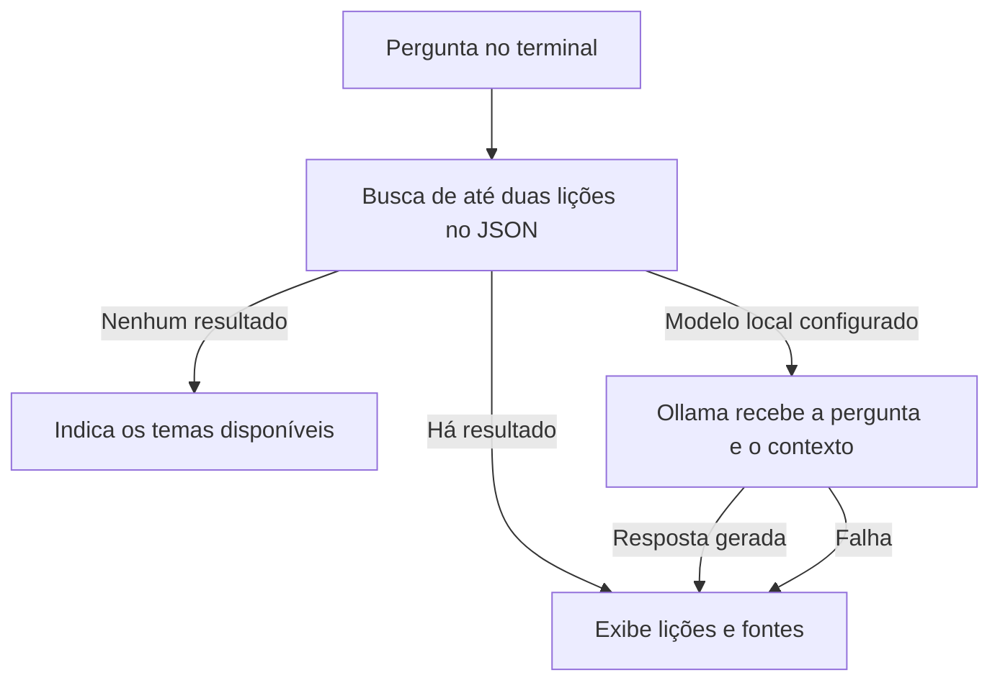

# Documentação do agente

## Caso de uso e persona

O GuiaPy ajuda iniciantes a tirar dúvidas sobre conceitos básicos de Python enquanto praticam exercícios. Ele dá uma explicação curta, um exemplo executável e uma referência à documentação oficial. Seu tom é direto e acolhedor.

## Arquitetura

Cada mensagem é avaliada de forma independente. A aplicação não grava conversas nem executa trechos enviados pelo usuário. A busca lexical pode deixar passar paráfrases que não incluam os termos cadastrados. O prompt e o contexto reduzem o risco de erros no texto gerado, mas a explicação do modelo ainda pode conter imprecisões. As lições e fontes são exibidas diretamente a partir da base.
